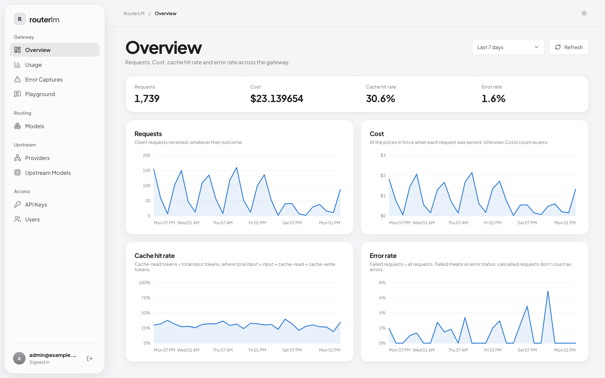
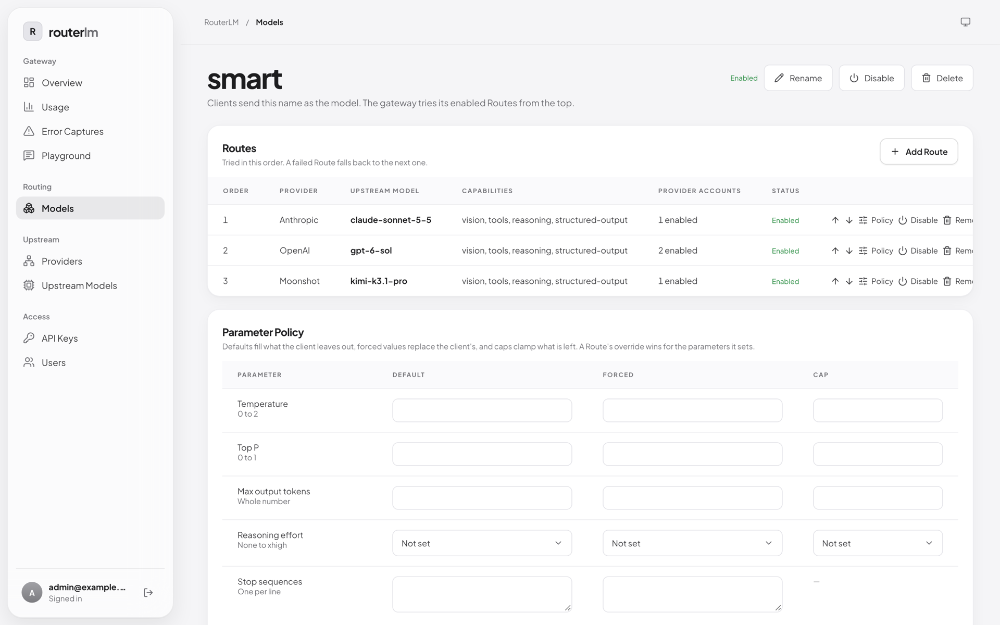
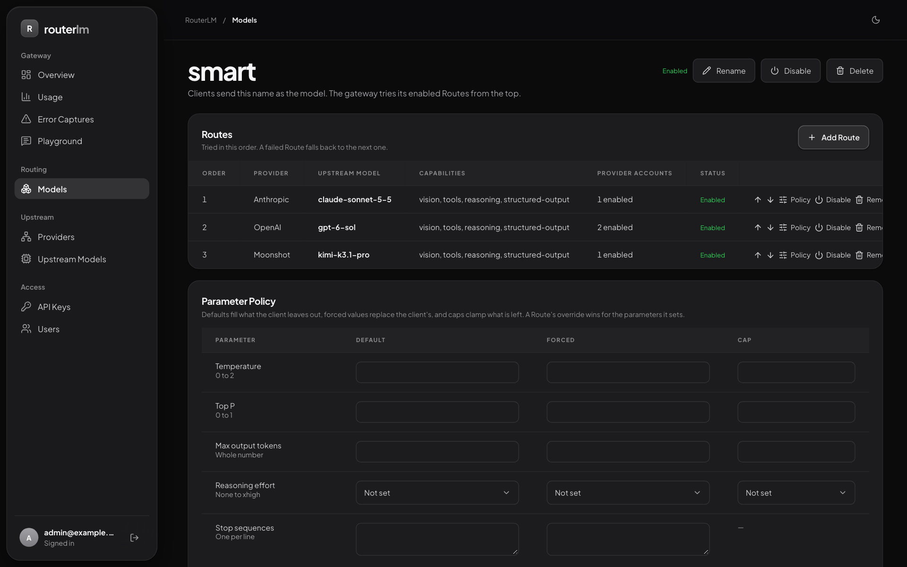
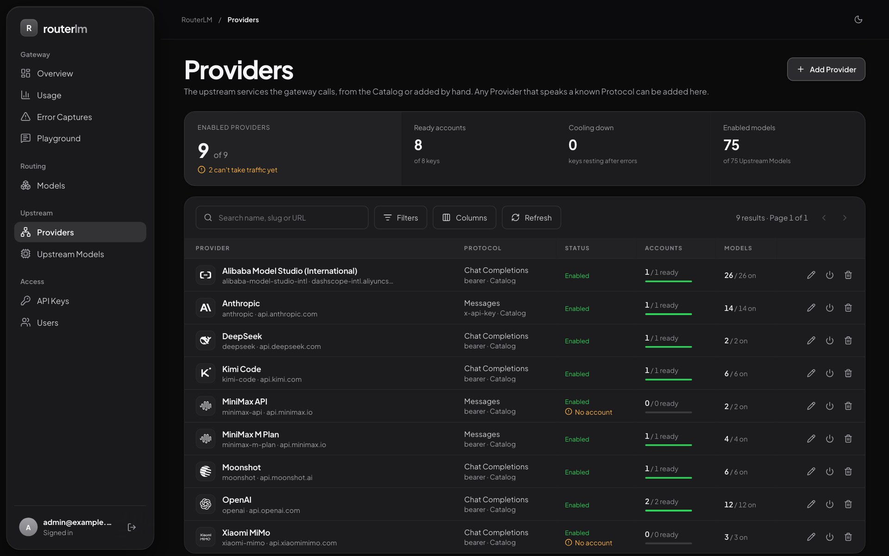
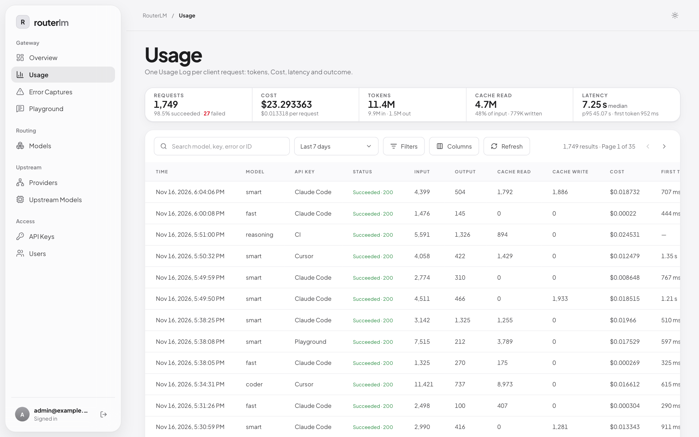
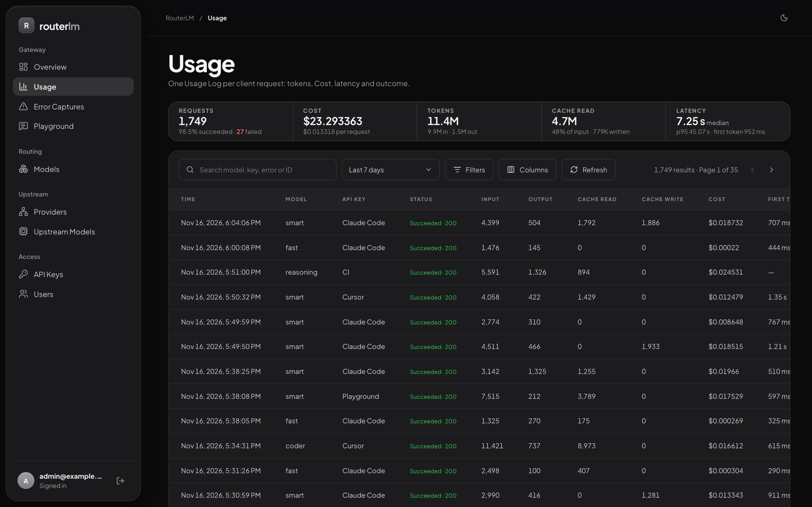
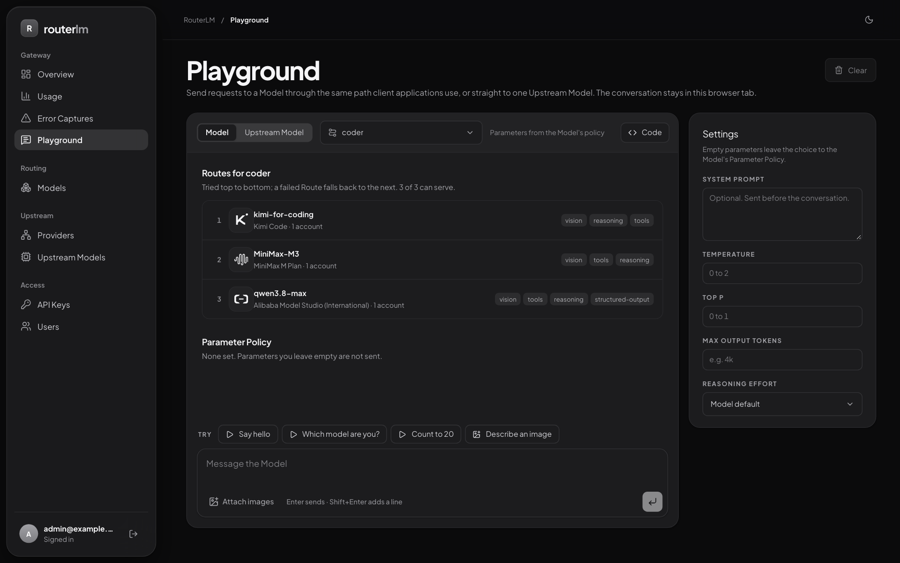
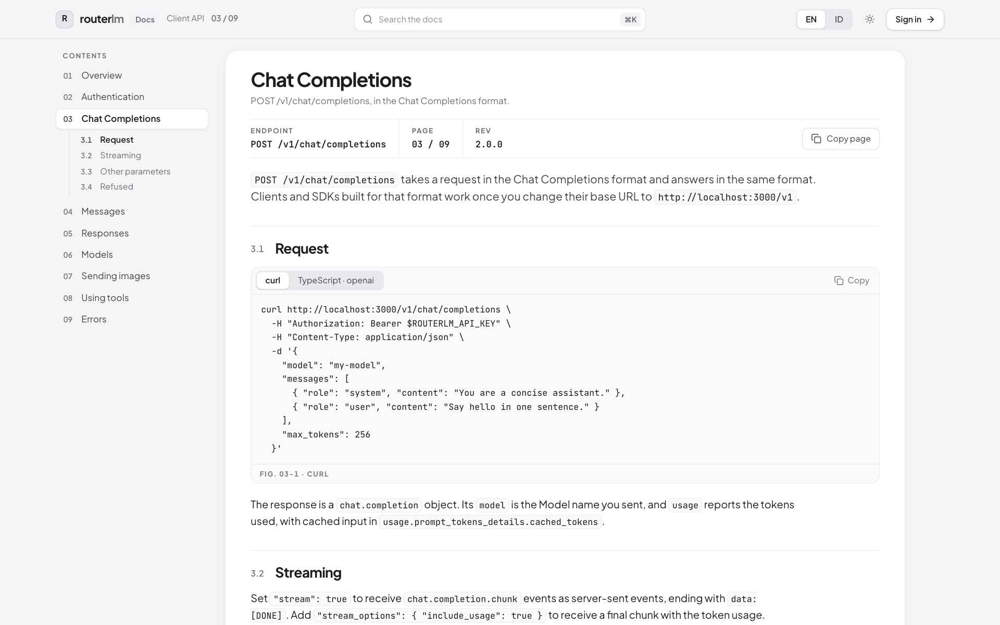
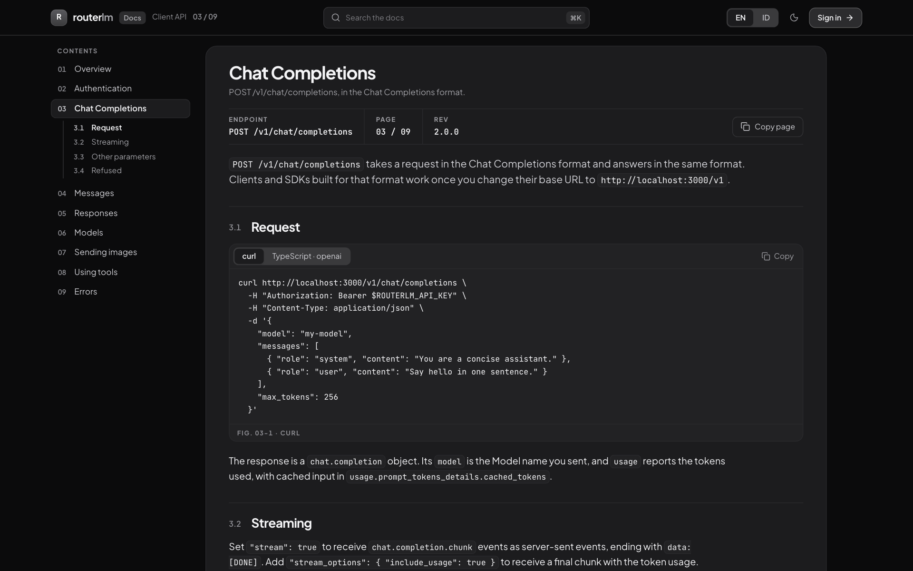

<h1 align="center">RouterLM</h1>

<p align="center">
  <strong>One endpoint for every model you pay for.</strong><br />
  A self-hosted AI gateway with fallback across providers, per-request cost tracking and a dashboard to run it all.
</p>

<p align="center">
  <a href="https://github.com/yhagus/routerlm-oss/releases/latest"></a>
  <a href="https://github.com/yhagus/routerlm-oss/actions/workflows/ci.yml"></a>
</p>

<p align="center">
  
  
</p>

## Why RouterLM

Your tools speak OpenAI or Anthropic. You keep keys at Anthropic, OpenAI, DeepSeek, Moonshot, MiniMax, Alibaba and a couple of coding plans. RouterLM sits between your tools and those providers:

- **One key per app.** Cursor, Claude Code, your CI and your internal tools each get their own `rlm_…` API Key, limited to the Models you allow.
- **Automatic fallback.** A Model is an ordered list of Routes. A rate limit, a 5xx or a timeout moves the request to the next Route, and the failing account rests in Cooldown.
- **Subscription plans, used to the last token.** Kimi Code and MiniMax M Plan accounts show their quota meters. RouterLM skips an exhausted account until its quota resets.
- **Know what every request cost.** RouterLM records tokens, cache reads and writes, latency, time to first token and USD cost for each request. You can view them per key and per Model.
- **Debug failures without logging prompts.** RouterLM never stores prompt or response content. It keeps only failed requests, as Error Captures with credentials redacted, for 30 days.

## Features

### Three client protocols, any upstream

Clients call `/v1/chat/completions`, `/v1/messages` or `/v1/responses`. RouterLM converts every request to one internal format. It then sends the request to an OpenAI Chat or Anthropic Messages upstream, with or without streaming. A Claude Code session can run on Kimi, and an OpenAI SDK app can run on Claude.

### Models and Routes

<p align="center">
  
  
</p>

A Model is the name clients send. RouterLM tries its Routes from the top. Each Model has a Parameter Policy: defaults, forced values, caps and a system prompt. A Route can override that policy. Routes also have their own timeouts, and Models can set automatic prompt cache breakpoints.

### Providers from the Catalog

<p align="center">
  
  
</p>

The Catalog ships Alibaba Model Studio Intl, Anthropic, DeepSeek, Kimi Code, MiniMax API, MiniMax M Plan, Moonshot, OpenAI and Xiaomi MiMo. Each entry has context sizes, capabilities, prices and release dates. Add a key to start using a Provider. You can add any other OpenAI- or Anthropic-compatible service by hand. Kimi Code also supports "Sign in with Kimi", and RouterLM keeps that login valid on its own.

### Usage you can search

<p align="center">
  
  
</p>

RouterLM records every request as a Usage Log with its Attempts. You can filter by Model, API Key or status, and search by text. The URL keeps the current view, so you can share it.

### Playground

<p align="center">
  
  
</p>

Send a request through a Model exactly as a client does, or send it directly to one upstream model. Then copy the matching code snippet.

### Client docs

<p align="center">
  
  
</p>

The web app serves public client docs at `/docs` (English) and `/id/docs` (Indonesian). Readers do not need to sign in. Each page covers one endpoint, with curl and TypeScript requests that use your gateway's URL. Readers can copy each request, and search all pages with ⌘K.

## Quick start

You need Docker with Compose.

```bash
git clone https://github.com/yhagus/routerlm-oss.git
cd routerlm-oss
sed "s|^ENCRYPTION_KEY=$|ENCRYPTION_KEY=$(openssl rand -base64 32)|" .env.example > .env
docker compose up -d
```

1. Open http://localhost:3001 and create the first user.
2. Under **Providers**, add a key to a Provider.
3. Under **Models**, create a Model and add Routes to it.
4. Under **API Keys**, create a key for your app.

Then point any OpenAI or Anthropic client at the gateway:

```bash
curl http://localhost:3000/v1/chat/completions \
  -H "Authorization: Bearer $RLM_API_KEY" \
  -H "Content-Type: application/json" \
  -d '{"model": "smart", "messages": [{"role": "user", "content": "Hello"}]}'
```

```bash
# Claude Code
export ANTHROPIC_BASE_URL=http://localhost:3000
export ANTHROPIC_AUTH_TOKEN=$RLM_API_KEY
```

The web app serves the full client docs at http://localhost:3001/docs.

> [!IMPORTANT]
> Back up `ENCRYPTION_KEY`. RouterLM encrypts Provider Account keys with it (AES-256-GCM). Without it, nobody can read those keys.

## Architecture

```
clients ──► backend (NestJS on Bun, :3000) ──► upstream providers
                │            │
                │            └─► Redis ──► worker (usage, Error Captures, retention)
                ▼
           PostgreSQL ◄── web dashboard (Nuxt, :3001)
```

| Service   | What it does                                                        |
| --------- | ------------------------------------------------------------------- |
| `backend` | Inference endpoints under `/v1` and the dashboard API under `/api`. |
| `worker`  | Writes Usage Logs and Error Captures, deletes expired captures.     |
| `web`     | The dashboard and the client docs.                                  |
| `db`      | PostgreSQL 18, through Drizzle ORM.                                 |
| `redis`   | BullMQ queues between backend and worker.                           |
| `migrate` | One-shot: applies migrations and seeds the Catalog on every `up`.   |

[GLOSSARY.md](GLOSSARY.md) defines the domain terms (Model, Route, Provider Account, Cooldown, Exhausted…). [docs/adr/](docs/adr/) records the design decisions.

## Configuration

Every variable has a development default in `docker-compose.yml`. Set your own values in `.env` (see [.env.example](.env.example)):

| Variable                       | Default   | Purpose                                         |
| ------------------------------ | --------- | ----------------------------------------------- |
| `ENCRYPTION_KEY`               | required  | Encrypts Provider Account keys. 32 bytes, base64. |
| `ERROR_CAPTURE_RETENTION_DAYS` | `30`      | Days to keep Error Captures.                    |
| `NUXT_PUBLIC_GATEWAY_URL`      | browser host, port `3000` | Gateway base URL shown in the `/docs` examples. |
| `BACKEND_PORT` / `WEB_PORT`    | `3000` / `3001` | Host ports.                               |
| `DB_PORT` / `REDIS_PORT`       | `5432` / `6379` | Host ports.                               |
| `POSTGRES_USER` / `POSTGRES_PASSWORD` / `POSTGRES_DB` | `routerlm` | Postgres uses them only when it first creates the db volume. |

## Development

### Checks and tests

```bash
bun install
bun run check            # lint, format, types (backend)
cd web && bun run check  # lint, format, types (web)
bun run test:docker      # feature tests against throwaway Postgres and Redis
```

There are no unit tests. Every test is a feature test in `tests/<feature>/`. It drives the app over HTTP, CLI or boot against real Postgres and Redis, with a fake upstream ([ADR 0009](docs/adr/0009-feature-tests-only.md)). `bun run test` runs them against `TEST_DATABASE_URL` and `REDIS_URL` you already have.

### Database

The schema lives in `src/db/schemas/`. After you change it, generate and apply a migration:

```bash
docker compose exec backend bun run db:generate
docker compose exec backend bun run db:migrate
```

### Catalog

The Catalog is one JSON file per Provider in `src/catalog/data/`. The seeder (`bun run db:seed`) only creates missing rows. It keeps your dashboard edits, and you can run it again safely. When you update a file:

- Take model ids, capabilities, context sizes and prices (USD per million tokens) from the Provider's own docs and pricing pages.
- Put those page URLs and the date you read them in `source`.
- Use `null` for a value the Provider doesn't publish. Never estimate one.
- `src/catalog/schemas/catalog.schema.ts` defines the file shape. `tests/catalog/` checks every shipped file.

### Demo data for screenshots

`bun run db:seed:demo` fills a database with a fictional install: Provider Accounts with fake keys, Models, API Keys and a week of traffic. Use it to capture the dashboard screenshots again. The script empties every table first, so it runs only when the database name ends in `_demo`.

Create and fill a demo database, then start the stack on it. Sign in as `admin@example.com` with the password `routerlm-demo`:

```bash
docker compose exec db createdb -U routerlm routerlm_demo
docker compose exec -e DATABASE_URL=postgres://routerlm:routerlm@db:5432/routerlm_demo backend bun run db:migrate
docker compose exec -e DATABASE_URL=postgres://routerlm:routerlm@db:5432/routerlm_demo backend bun run db:seed:demo
POSTGRES_DB=routerlm_demo docker compose up -d
```

### Project conventions

Backend modules follow a CQRS folder layout and prefer first-party `@nestjs/*` packages. See [AGENTS.md](AGENTS.md) and [docs/adr/](docs/adr/).

## Upgrading from v1

v2 is a rewrite and does not import v1 data. The v1 app (Bun + Hono + Vue, SQLite) stays in [`legacy/`](legacy/). Its npm package `@ciwergrp/routerlm` and image `ghcr.io/yhagus/routerlm-oss` stay at 1.6.5. See [CHANGELOG.md](CHANGELOG.md).

## License

[MIT](LICENSE)
