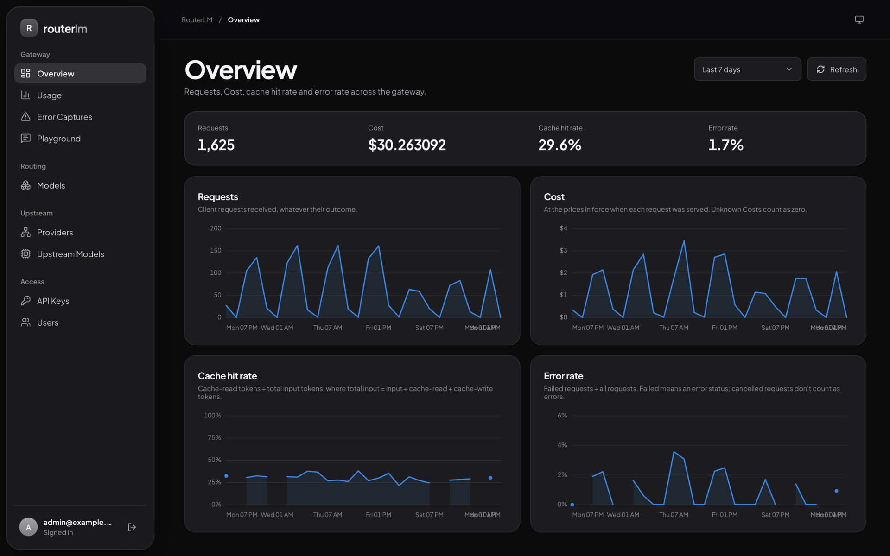

<h1 align="center">RouterLM</h1>

<p align="center">
  <strong>One endpoint for every model you pay for.</strong><br />
  A self-hosted AI gateway with fallback across providers, per-request cost tracking and a dashboard to run it all.
</p>

<p align="center">
  <a href="https://github.com/yhagus/routerlm-oss/releases/latest"></a>
  <a href="https://github.com/yhagus/routerlm-oss/actions/workflows/ci.yml"></a>
</p>

<p align="center">
  
  
</p>

## Why RouterLM

Your tools speak OpenAI or Anthropic. You keep keys at Anthropic, OpenAI, DeepSeek, Moonshot, MiniMax, Alibaba and a couple of coding plans. RouterLM sits between your tools and those providers:

- **One key per app.** Cursor, Claude Code, your CI and your internal tools each get their own `rlm_…` API Key, limited to the Models you allow.
- **Automatic fallback.** A Model is an ordered list of Routes. A rate limit, a 5xx or a timeout moves the request to the next Route, and the failing account rests in Cooldown.
- **Subscription plans, used to the last token.** Kimi Code and MiniMax M Plan accounts show their quota meters. RouterLM skips an exhausted account until its quota resets.
- **Know what every request cost.** RouterLM records tokens, cache reads and writes, latency, time to first token and USD cost for each request. You can view them per key and per Model.
- **Debug failures without logging prompts.** RouterLM never stores prompt or response content. It keeps only failed requests, as Error Captures with credentials redacted, for 7 days by default (`ERROR_CAPTURE_RETENTION_DAYS`).

## Quick start

You need Docker with Compose. No clone: each release publishes the images `ghcr.io/yhagus/routerlm-backend` and `ghcr.io/yhagus/routerlm-web` (amd64 and arm64) and a `compose.yaml` that runs them.

```bash
mkdir routerlm && cd routerlm
curl -LO https://github.com/yhagus/routerlm-oss/releases/latest/download/compose.yaml
curl -L https://github.com/yhagus/routerlm-oss/releases/latest/download/env.example \
  | sed -e "s|^ENCRYPTION_KEY=$|ENCRYPTION_KEY=$(openssl rand -base64 32)|" \
        -e "s|^POSTGRES_PASSWORD=$|POSTGRES_PASSWORD=$(openssl rand -hex 16)|" > .env
docker compose up -d
```

1. Open http://localhost:3001 and create the first user.
2. Under **Providers**, add a key to a Provider.
3. Under **Models**, create a Model and add Routes to it.
4. Under **API Keys**, create a key for your app.

Then point any OpenAI or Anthropic client at the gateway:

```bash
curl http://localhost:3000/v1/chat/completions \
  -H "Authorization: Bearer $RLM_API_KEY" \
  -H "Content-Type: application/json" \
  -d '{"model": "smart", "messages": [{"role": "user", "content": "Hello"}]}'
```

```bash
# Claude Code
export ANTHROPIC_BASE_URL=http://localhost:3000
export ANTHROPIC_AUTH_TOKEN=$RLM_API_KEY
```

The web app serves the full client docs at http://localhost:3001/docs.

> [!IMPORTANT]
> Back up `ENCRYPTION_KEY`. RouterLM encrypts Provider Account keys with it (AES-256-GCM). Without it, nobody can read those keys.

The stack publishes the gateway on port 3000 and the dashboard on 3001, over plain HTTP. Put your own reverse proxy with TLS in front of them, and set `WEB_ORIGIN` to the dashboard's public URL.

## Architecture

```
clients ──► backend (NestJS on Bun, :3000) ──► upstream providers
                │            │
                │            └─► Redis ──► worker (usage, Error Captures, retention)
                ▼
           PostgreSQL ◄── web dashboard (Nuxt, :3001)
```

| Service   | What it does                                                        |
| --------- | ------------------------------------------------------------------- |
| `backend` | Inference endpoints under `/v1` and the dashboard API under `/api`. |
| `worker`  | Writes Usage Logs and Error Captures, deletes expired captures.     |
| `web`     | The dashboard and the client docs.                                  |
| `db`      | PostgreSQL 18, through Drizzle ORM.                                 |
| `redis`   | BullMQ queues between backend and worker.                           |
| `migrate` | One-shot: applies migrations and seeds the Catalog on every `up`.   |

[GLOSSARY.md](GLOSSARY.md) defines the domain terms (Model, Route, Provider Account, Cooldown, Exhausted…). [docs/adr/](docs/adr/) records the design decisions.

## Benchmark

We measured the gateway with [k6](https://k6.io). The test stack has a fake upstream, so the results show the cost of RouterLM, not the cost of a Provider. Run the same test with `bun run perf:k6`. [tests/k6/README.md](tests/k6/README.md) describes the setup and the other scenarios.

**Host:** Docker Desktop on macOS, Apple M3 Pro. The Docker VM has 4 CPUs and 7.6 GB of RAM.

**Nodes:**

| Node                  | Spec                                     |
| --------------------- | ---------------------------------------- |
| Gateway               | 2 CPU / 2 GB: 2 replicas of 1 CPU / 1 GB |
| Worker                | 1 CPU / 1 GB                             |
| PostgreSQL            | 1 CPU / 1 GB                             |
| Redis                 | 0.5 CPU / 512 MB                         |
| Fake upstream         | 1 CPU / 512 MB (test equipment)          |
| Load balancer (nginx) | 1 CPU / 256 MB (test equipment)          |
| k6                    | uncapped (test equipment)                |

**Scenarios:** each scenario ran for one minute on a fresh stack. Every virtual user (VU) sends its next request as soon as the last one ends.

1. **Gateway alone:** the fake upstream answers at once with 20 tokens. This scenario shows how much traffic the gateway can carry.
2. **End to end:** the fake upstream waits 200 ms, then streams 200 tokens at 100 tokens/s. One answer takes about 2.2 s. This scenario shows what a client sees through a realistic upstream.

| Result               | 1. Gateway alone | 2. End to end   |
| -------------------- | ---------------- | --------------- |
| VUs                  | 300              | 1,800           |
| Total time           | 60 s             | 63 s            |
| Total requests       | 125,525          | 27,784          |
| Requests per second  | 2,081            | 444             |
| Failed requests      | 0 (0.00%)        | 0 (0.00%)       |
| Latency median / p95 | 101 ms / 335 ms  | 3.31 s / 6.01 s |
| Out-of-memory kills  | none             | none            |

**Resource use:** average CPU and RAM per node, sampled about every 5 s while k6 ran. A percentage is the share of that node's limit.

| Node                  | 1. CPU           | 1. RAM        | 2. CPU           | 2. RAM        |
| --------------------- | ---------------- | ------------- | ---------------- | ------------- |
| Gateway               | 1.59 cores (79%) | 366 MiB (18%) | 1.34 cores (67%) | 528 MiB (26%) |
| Worker                | 0.30 cores (30%) | 85 MiB (8%)   | 0.26 cores (26%) | 85 MiB (8%)   |
| PostgreSQL            | 0.39 cores (39%) | 112 MiB (11%) | 0.35 cores (35%) | 124 MiB (12%) |
| Redis                 | 0.24 cores (47%) | 93 MiB (18%)  | 0.10 cores (20%) | 15 MiB (3%)   |
| Fake upstream         | 0.16 cores (16%) | 30 MiB (6%)   | 0.46 cores (46%) | 53 MiB (10%)  |
| Load balancer (nginx) | 0.17 cores (17%) | 36 MiB (14%)  | 0.27 cores (27%) | 65 MiB (25%)  |
| k6                    | 0.49 cores       | 171 MiB       | 0.61 cores       | 834 MiB       |

k6 and the fake upstream share the host with the stack, so results can change by about 20% between runs on a laptop.

## Configuration

Set these in the `.env` next to `compose.yaml` (see [deploy/.env.example](deploy/.env.example)). Settings a User changes in the dashboard, such as the Error Capture Retention Period, live in the database instead.

| Variable                        | Default                   | Purpose                                                      |
| ------------------------------- | ------------------------- | ------------------------------------------------------------ |
| `ENCRYPTION_KEY`                | required                  | Encrypts Provider Account keys. 32 bytes, base64.            |
| `POSTGRES_PASSWORD`             | required                  | Postgres uses it only when it first creates the db volume.   |
| `ROUTERLM_VERSION`              | the release's version     | The image version to run.                                    |
| `WEB_ORIGIN`                    | `http://localhost:3001`   | The dashboard's public URL.                                  |
| `NUXT_PUBLIC_GATEWAY_URL`       | browser host, port `3000` | Gateway base URL shown in the `/docs` examples.              |
| `BACKEND_PORT` / `WEB_PORT`     | `3000` / `3001`           | Host ports.                                                  |
| `POSTGRES_USER` / `POSTGRES_DB` | `routerlm`                | Postgres uses them only when it first creates the db volume. |

## Development

The development stack in `docker-compose.yml` builds from the source and reloads on change:

```bash
git clone https://github.com/yhagus/routerlm-oss.git
cd routerlm-oss
sed "s|^ENCRYPTION_KEY=$|ENCRYPTION_KEY=$(openssl rand -base64 32)|" .env.example > .env
docker compose up -d
```

It takes its project name from the folder. For a default clone, that name is `routerlm-oss`, the same name that `deploy/compose.yaml` uses. In that folder, the two stacks share containers and data.

To try the production images on a development machine, build them and run `scripts/smoke-production.sh`. The script uses its own project name and throwaway volumes:

```bash
docker build --target production -t ghcr.io/yhagus/routerlm-backend:local .
docker build --target production -t ghcr.io/yhagus/routerlm-web:local web
ROUTERLM_VERSION=local scripts/smoke-production.sh
```

[AGENTS.md](AGENTS.md) lists the checks, the test setup and the project conventions.

## License

[Apache License 2.0](LICENSE). Third-party attributions are in [NOTICE](NOTICE).
