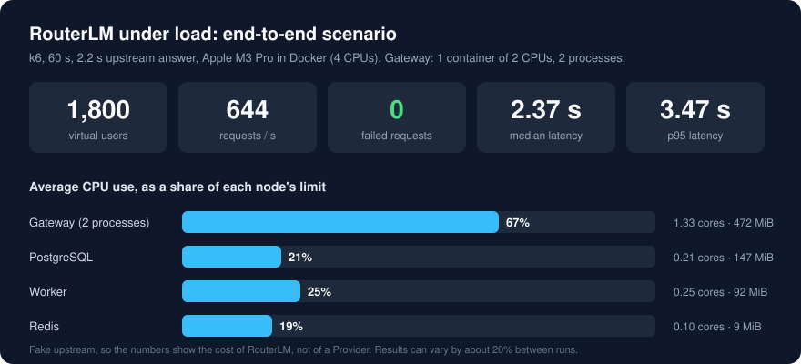

<div align="center">

  <picture>
    <source media="(prefers-color-scheme: dark)" srcset="docs/images/overview-dark.png" />
    
  </picture>

  # RouterLM

  **One endpoint for every model you pay for.**

  A self-hosted AI gateway with fallback across providers, per-request cost tracking and a dashboard to run it all.

  [](https://github.com/yhagus/routerlm-oss/releases/latest)
  [](https://github.com/yhagus/routerlm-oss/actions/workflows/ci.yml)
  [](https://github.com/yhagus?tab=packages&repo_name=routerlm-oss)
  [](LICENSE)

  [Quick start](#quick-start) • [Endpoints](#endpoints) • [Configuration](#configuration) • [Development](#development)

</div>

---

## Why RouterLM?

Your tools speak OpenAI or Anthropic. You keep keys at Anthropic, OpenAI, DeepSeek, Moonshot, MiniMax, Alibaba and a couple of coding plans.

**RouterLM sits between your tools and those providers:**

- **One key per app.** Cursor, Claude Code, your CI and your internal tools each get their own `rlm_…` API Key, limited to the Models you allow. Copy, edit or rotate a key from the dashboard, and see the history of its rotations.
- **Chat and media.** Besides chat, a Model can generate and edit images, synthesize speech, transcribe audio or run video jobs. Alibaba Model Studio serves these Kinds today.
- **Automatic fallback.** A Model is an ordered list of Routes. A rate limit, a 5xx or a timeout moves the request to the next Route, and the failing account rests in Cooldown.
- **Subscription plans, used to the last token.** Kimi Code and MiniMax M Plan accounts show their quota meters. RouterLM skips an exhausted account until its quota resets.
- **Know what every request cost.** RouterLM records tokens, cache reads and writes, latency, time to first token and USD cost for each request. View them per key and per Model.
- **Debug failures without logging prompts.** RouterLM never stores prompt or response content. It keeps only failed requests, as Error Captures with credentials redacted, for 7 days by default.

---

## Quick start

You need Docker with Compose. No clone is necessary: each release publishes the images `ghcr.io/yhagus/routerlm-backend` and `ghcr.io/yhagus/routerlm-web` (amd64 and arm64) and a `compose.yaml` that runs them.

**1. Download and start the stack:**

```bash
mkdir routerlm && cd routerlm
curl -LO https://github.com/yhagus/routerlm-oss/releases/latest/download/compose.yaml
curl -L https://github.com/yhagus/routerlm-oss/releases/latest/download/env.example \
  | sed -e "s|^ENCRYPTION_KEY=$|ENCRYPTION_KEY=$(openssl rand -base64 32)|" \
        -e "s|^POSTGRES_PASSWORD=$|POSTGRES_PASSWORD=$(openssl rand -hex 16)|" > .env
docker compose up -d
```

The dashboard opens at http://localhost:3001. Create the first user there.

**2. Set up a route in the dashboard:**

```
Providers → add a key to a Provider
Models    → create a Model and add Routes to it
API Keys  → create a key for your app
```

**3. Point any OpenAI or Anthropic client at the gateway:**

```bash
curl http://localhost:3000/v1/chat/completions \
  -H "Authorization: Bearer $RLM_API_KEY" \
  -H "Content-Type: application/json" \
  -d '{"model": "smart", "messages": [{"role": "user", "content": "Hello"}]}'
```

```bash
# Claude Code
export ANTHROPIC_BASE_URL=http://localhost:3000
export ANTHROPIC_AUTH_TOKEN=$RLM_API_KEY
```

The web app serves the full client docs at http://localhost:3001/docs.

> **Back up `ENCRYPTION_KEY`.** RouterLM encrypts Provider Account keys and API Keys with it (AES-256-GCM). Without it, nobody can read the Provider Account keys, and the dashboard can no longer copy the API Keys. The API Keys still work, because RouterLM checks them against a hash.

> **Going to production:** by default the stack serves the gateway on port 3000 and the dashboard on 3001, over plain HTTP. Set `ROUTERLM_API_ADDRESS` and `ROUTERLM_DASHBOARD_ADDRESS` in `.env` to two hostnames whose DNS points at the machine, open ports 80 and 443, and set `WEB_ORIGIN` and `NUXT_PUBLIC_GATEWAY_URL` to the new URLs. The bundled Caddy then serves both over HTTPS and gets the certificates itself.
>
> The gateway does not rate limit `/v1`. Set rate limits in Caddy, or in a proxy in front of it.

---

## Endpoints

One API Key calls every endpoint. A media endpoint answers only for Models of its Kind.

| Endpoint                                                                 | Format                  | Model Kind    |
| ------------------------------------------------------------------------ | ----------------------- | ------------- |
| `POST /v1/chat/completions`                                              | OpenAI Chat Completions | chat          |
| `POST /v1/responses`                                                     | OpenAI Responses        | chat          |
| `POST /v1/messages`                                                      | Anthropic Messages      | chat          |
| `POST /v1/images/generations`, `POST /v1/images/edits`                   | Images                  | image         |
| `POST /v1/audio/speech`                                                  | Speech                  | speech        |
| `POST /v1/audio/transcriptions`                                          | Transcription           | transcription |
| `POST /v1/videos`, `GET /v1/videos/{id}`, `GET /v1/videos/{id}/content`  | Videos                  | video         |
| `GET /v1/models`                                                         | Model list              | all           |

The client docs at http://localhost:3001/docs describe each format.

---

## Architecture

```
clients ──► caddy :3000 ─┬─ /v1, /health ──────► inference ──► upstream providers
                         └─ /integration/v1 ──► admin
browser ──► caddy :3001 ──► web ── /api ──────► admin
inference, admin ──► PostgreSQL, Redis ──► worker (usage, Error Captures, retention)
```

The backend runs as two containers of the same image, so Customers' inference never competes with the dashboard, the Playground or the control plane for the same processes and database connections ([ADR 0094](docs/adr/0094-backend-roles-split-inference-from-admin-behind-an-edge-proxy.md)). The dashboard API is never on a public port.

| Service     | What it does                                                        |
| ----------- | ------------------------------------------------------------------- |
| `caddy`     | The edge proxy: the only service on the host's ports. Routes by path, balances inference replicas, and serves HTTPS when given hostnames. |
| `inference` | Inference endpoints under `/v1` (`BACKEND_ROLE=inference`).         |
| `admin`     | The dashboard API under `/api`, the Playground and the control plane under `/integration/v1` (`BACKEND_ROLE=admin`). |
| `worker`  | Writes Usage Logs and Error Captures, deletes expired captures; serves the control plane over gRPC when `CONTROL_PLANE_PORT` is set. |
| `web`     | The dashboard and the client docs.                                  |
| `db`      | PostgreSQL 18, through Drizzle ORM.                                 |
| `redis`     | BullMQ queues between the backend and the worker.                   |
| `migrate` | One-shot: applies migrations and seeds the Catalog on every `up`.   |

[GLOSSARY.md](GLOSSARY.md) defines the domain terms (Model, Route, Provider Account, Cooldown, Exhausted…). [docs/adr/](docs/adr/) records the design decisions.

---

## Benchmark

We measured the gateway with [k6](https://k6.io) against a fake upstream, so the results show the cost of RouterLM, not the cost of a Provider.



End-to-end scenario: the fake upstream waits 200 ms, then streams 200 tokens at 100 tokens/s. Each virtual user (VU) sends its next request as soon as the last one ends. The run lasted one minute on a fresh stack.

<details>
<summary><b>Test setup</b></summary>

- **Host:** Docker Desktop on macOS, Apple M3 Pro, with 4 CPUs and 7.6 GB of RAM for the Docker VM.
- **Gateway:** 1 container of 2 CPUs / 2 GB, running 2 processes (`BACKEND_PROCESSES=2`).
- **Worker:** 1 CPU / 1 GB.
- **PostgreSQL:** 1 CPU / 1 GB.
- **Redis:** 0.5 CPU / 512 MB.

Run the same test with `TOPOLOGY=cluster bun run perf:k6`. [tests/k6/README.md](tests/k6/README.md) describes the setup and the other scenarios.

</details>

---

## Configuration

Set environment variables in the `.env` next to `compose.yaml` (see [deploy/.env.example](deploy/.env.example)).

Settings a User changes in the dashboard live in the database instead. Examples are the Error Capture Retention Period and "Allow private upstreams". Turn on "Allow private upstreams" to give a Provider an http URL or a host on your network, such as Ollama or vLLM.

<details>
<summary><b>Environment variables</b></summary>

| Variable                        | Default                   | Purpose                                                                  |
| ------------------------------- | ------------------------- | ------------------------------------------------------------------------ |
| `ENCRYPTION_KEY`                | required                  | Encrypts Provider Account keys and API Keys. 32 bytes, base64.           |
| `POSTGRES_PASSWORD`             | required                  | Postgres uses it only when it first creates the db volume.               |
| `ROUTERLM_VERSION`              | the release's version     | The image version to run.                                                |
| `ROUTERLM_API_ADDRESS`          | `:3000`                   | What Caddy serves the gateway on. A hostname turns on HTTPS.             |
| `ROUTERLM_DASHBOARD_ADDRESS`    | `:3001`                   | What Caddy serves the dashboard on. A hostname turns on HTTPS.           |
| `WEB_ORIGIN`                    | `http://localhost:3001`   | The dashboard's public URL.                                              |
| `NUXT_PUBLIC_GATEWAY_URL`       | browser host, port `3000` | Gateway base URL shown in the `/docs` examples.                          |
| `SNAPSHOT_RELOAD_INTERVAL_MS`   | `30000`                   | How often each backend instance reloads its snapshot (ms).               |
| `INFERENCE_PROCESSES`           | `1`                       | Gateway processes in the inference container. Give it the VM's CPUs.     |
| `ADMIN_PROCESSES`               | `1`                       | Gateway processes in the admin container.                                |
| `ROUTERLM_SUBNET`               | `172.29.84.0/24`          | The compose network, and the only `X-Forwarded-For` source trusted.      |
| `BACKEND_PORT` / `WEB_PORT`     | `3000` / `3001`           | Host ports for the API and the dashboard over plain HTTP.                |
| `HTTP_PORT` / `HTTPS_PORT`      | `80` / `443`              | Host ports Caddy uses for hostname addresses.                            |
| `POSTGRES_USER` / `POSTGRES_DB` | `routerlm`                | Postgres uses them only when it first creates the db volume.             |
| `CONTROL_PLANE_PORT`            | unset                     | The worker's gRPC port for Integrations. Unset: no gRPC server starts.   |

</details>

<details>
<summary><b>Control plane over gRPC</b></summary>

An Integration manages its Customers' API Keys through the control plane: over HTTP/JSON under `/integration/v1` on the gateway's address, or over gRPC. Both serve [src/control-plane/data/control_plane.proto](src/control-plane/data/control_plane.proto) with the same results ([ADR 0033](docs/adr/0033-integrations-manage-keys-through-one-contract-over-http-and-grpc.md)).

Set `CONTROL_PLANE_PORT` (for example `50051`) to have the worker serve gRPC on that port. It is plaintext HTTP/2 (h2c), with no TLS. The Integration Secret goes in the `authorization` metadata as `Bearer rlmi_…`.

Never publish this port to the internet. The worker runs on Bun, whose HTTP/2 server accepts but ignores some flood and reset protections (such as limits on rapid stream resets). Keep the port on a private network that only your Integrations reach, or put a TLS proxy in front that speaks h2c to the worker. The compose file passes the variable to the worker but publishes no port: services on the compose network reach it at `worker:<port>`. Integrations on the public internet should use the HTTP adapter through Caddy instead.

</details>

---

## Development

The development stack in `docker-compose.yml` builds from the source and reloads on change:

```bash
git clone https://github.com/yhagus/routerlm-oss.git
cd routerlm-oss
sed "s|^ENCRYPTION_KEY=$|ENCRYPTION_KEY=$(openssl rand -base64 32)|" .env.example > .env
docker compose up -d
```

It takes its project name from the folder. For a default clone, that name is `routerlm-oss`, the same name that `deploy/compose.yaml` uses. In that folder, the two stacks share containers and data.

It runs the same layout as `deploy/compose.yaml`: Caddy on `localhost:3000` sends `/v1` and `/health` to the `inference` container and `/integration/v1` to `admin`, and `localhost:3001` serves the dashboard, whose `/api` reaches `admin` on the compose network only. Both backend containers reload on change. It uses plain HTTP and ports instead of HTTPS and hostnames.

Unlike `deploy/compose.yaml`, the development stack always serves the control plane over gRPC and publishes it on `127.0.0.1:50051` (change the host port with `CONTROL_PLANE_PORT`).

<details>
<summary><b>Try the production images locally</b></summary>

Build the images and run `scripts/smoke-production.sh`. The script uses its own project name and throwaway volumes:

```bash
docker build --target production -t ghcr.io/yhagus/routerlm-backend:local .
docker build --target production -t ghcr.io/yhagus/routerlm-web:local web
ROUTERLM_VERSION=local scripts/smoke-production.sh
```

</details>

[AGENTS.md](AGENTS.md) lists the checks, the test setup and the project conventions.

---

## License

[Apache License 2.0](LICENSE).
