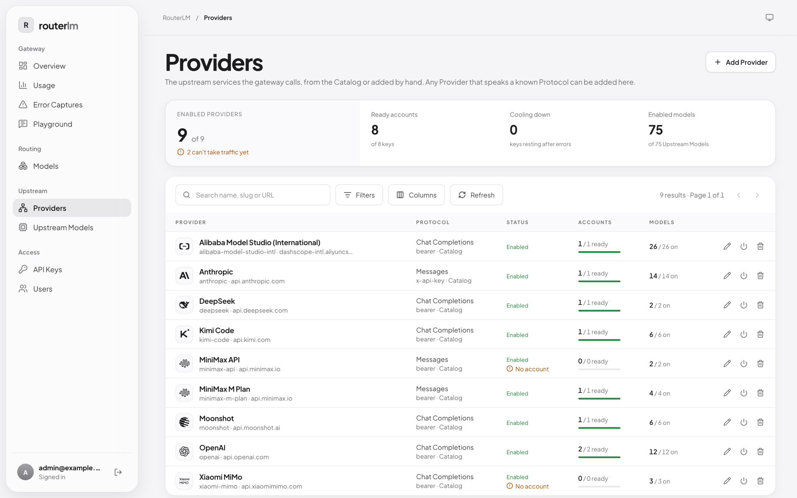
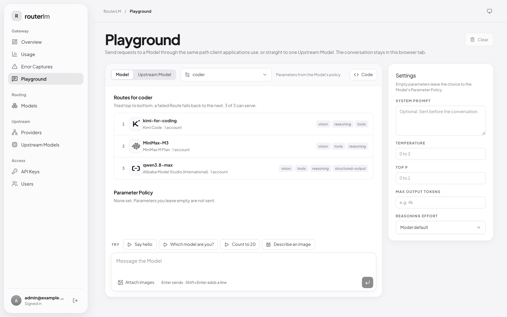

<h1 align="center">RouterLM</h1>

<p align="center">
  <strong>One endpoint for every model you pay for.</strong><br />
  A self-hosted AI gateway with fallback across providers, per-request cost tracking and a dashboard to run it all.
</p>

<p align="center">
  <a href="https://github.com/yhagus/routerlm-oss/releases/latest"></a>
  <a href="https://github.com/yhagus/routerlm-oss/actions/workflows/ci.yml"></a>
</p>

<picture>
  <source media="(prefers-color-scheme: dark)" srcset="docs/images/overview-dark.png" />
  
</picture>

## Why RouterLM

Your tools speak OpenAI or Anthropic. Your keys are spread over Anthropic, OpenAI, DeepSeek, Moonshot, MiniMax, Alibaba and a couple of coding plans. RouterLM sits in between:

- **One key per app.** Cursor, Claude Code, your CI and your internal tools each get their own `rlm_…` API Key, limited to the Models you allow.
- **Fallback that just works.** A Model is an ordered list of Routes. A rate limit, a 5xx or a timeout moves the request to the next Route, and the failing account rests in Cooldown.
- **Subscription plans, used to the last token.** Kimi Code and MiniMax M Plan accounts show their quota meters. An exhausted account is skipped until it resets.
- **Know what every request cost.** Tokens, cache reads and writes, latency, time to first token and USD cost for each request, per key and per Model.
- **Debug failures without logging prompts.** RouterLM never stores prompt or response content. Only failed requests are kept, as Error Captures with credentials redacted, for 30 days.

## Features

### Three client protocols, any upstream

Clients call `/v1/chat/completions`, `/v1/messages` or `/v1/responses`. Every request is converted to one internal format and sent to an OpenAI Chat or Anthropic Messages upstream, streamed or not. A Claude Code session can run on Kimi, and an OpenAI SDK app can run on Claude.

### Models and Routes


A Model is the name clients send. Its Routes are tried from the top. Each Model has a Parameter Policy (defaults, forced values, caps and a system prompt) that a Route can override, plus per-Route timeouts and automatic prompt cache breakpoints.

### Providers from the Catalog



The Catalog ships Alibaba Model Studio Intl, Anthropic, DeepSeek, Kimi Code, MiniMax API, MiniMax M Plan, Moonshot, OpenAI and Xiaomi MiMo, with context sizes, capabilities, prices and release dates. Add a key and go. Any other OpenAI- or Anthropic-compatible service can be added by hand. Kimi Code also supports "Sign in with Kimi", and RouterLM keeps that login valid on its own.

### Usage you can search


Every request is a Usage Log with its Attempts. Filter by Model, API Key or status, search by text, and keep the view in the URL to share it.

### Playground



Send a request through a Model exactly as a client would, or straight to one upstream model, and copy the matching code snippet.

## Quick start

You need Docker with Compose.

```bash
git clone https://github.com/yhagus/routerlm-oss.git
cd routerlm-oss
sed "s|^ENCRYPTION_KEY=$|ENCRYPTION_KEY=$(openssl rand -base64 32)|" .env.example > .env
docker compose up -d
```

1. Open http://localhost:3001 and create the first user.
2. Under **Providers**, add a key to a Provider.
3. Under **Models**, create a Model and add Routes to it.
4. Under **API Keys**, create a key for your app.

Then point any OpenAI or Anthropic client at the gateway:

```bash
curl http://localhost:3000/v1/chat/completions \
  -H "Authorization: Bearer $RLM_API_KEY" \
  -H "Content-Type: application/json" \
  -d '{"model": "smart", "messages": [{"role": "user", "content": "Hello"}]}'
```

```bash
# Claude Code
export ANTHROPIC_BASE_URL=http://localhost:3000
export ANTHROPIC_AUTH_TOKEN=$RLM_API_KEY
```

The dashboard has full client documentation at http://localhost:3001/docs.

> [!IMPORTANT]
> Back up `ENCRYPTION_KEY`. Provider Account keys are encrypted with it (AES-256-GCM), and they can't be read without it.

## Architecture

```
clients ──► backend (NestJS on Bun, :3000) ──► upstream providers
                │            │
                │            └─► Redis ──► worker (usage, Error Captures, retention)
                ▼
           PostgreSQL ◄── web dashboard (Nuxt, :3001)
```

| Service   | What it does                                                        |
| --------- | ------------------------------------------------------------------- |
| `backend` | Inference endpoints under `/v1` and the dashboard API under `/api`. |
| `worker`  | Writes Usage Logs and Error Captures, deletes expired captures.     |
| `web`     | The dashboard and the client docs.                                  |
| `db`      | PostgreSQL 18, through Drizzle ORM.                                 |
| `redis`   | BullMQ queues between backend and worker.                           |
| `migrate` | One-shot: applies migrations and seeds the Catalog on every `up`.   |

The domain terms (Model, Route, Provider Account, Cooldown, Exhausted…) are defined in [GLOSSARY.md](GLOSSARY.md). Design decisions are in [docs/adr/](docs/adr/).

## Configuration

Everything has a development default in `docker-compose.yml`. Override values in `.env` (see [.env.example](.env.example)):

| Variable                       | Default   | Purpose                                         |
| ------------------------------ | --------- | ----------------------------------------------- |
| `ENCRYPTION_KEY`               | required  | Encrypts Provider Account keys. 32 bytes, base64. |
| `ERROR_CAPTURE_RETENTION_DAYS` | `30`      | Days to keep Error Captures.                    |
| `BACKEND_PORT` / `WEB_PORT`    | `3000` / `3001` | Host ports.                               |
| `DB_PORT` / `REDIS_PORT`       | `5432` / `6379` | Host ports.                               |
| `POSTGRES_USER` / `POSTGRES_PASSWORD` / `POSTGRES_DB` | `routerlm` | Applied when the db volume is first created. |

## Development

### Checks and tests

```bash
bun install
bun run check            # lint, format, types (backend)
cd web && bun run check  # lint, format, types (web)
bun run test:docker      # feature tests against throwaway Postgres and Redis
```

There are no unit tests. Every test is a feature test in `tests/<feature>/` that drives the app over HTTP, CLI or boot against real Postgres and Redis, with a fake upstream ([ADR 0009](docs/adr/0009-feature-tests-only.md)). `bun run test` runs them against `TEST_DATABASE_URL` and `REDIS_URL` you already have.

### Database

The schema lives in `src/db/schemas/`. After changing it, generate and apply a migration:

```bash
docker compose exec backend bun run db:generate
docker compose exec backend bun run db:migrate
```

### Catalog

The Catalog is one JSON file per Provider in `src/catalog/data/`. The seeder only creates missing rows, so dashboard edits survive and it is safe to run again (`bun run db:seed`). When you update a file:

- Take model ids, capabilities, context sizes and prices (USD per million tokens) from the Provider's own docs and pricing pages, and put those URLs and the date in `source`.
- Use `null` for a value the Provider doesn't publish. Never estimate one.
- The file shape is defined in `src/catalog/schemas/catalog.schema.ts`. `tests/catalog/` checks every shipped file.

### Project conventions

Backend modules follow a CQRS folder layout and prefer first-party `@nestjs/*` packages. See [AGENTS.md](AGENTS.md) and [docs/adr/](docs/adr/).

## Upgrading from v1

v2 is a rewrite and does not import v1 data. The v1 app (Bun + Hono + Vue, SQLite) is kept in [`legacy/`](legacy/), and its npm package `@ciwergrp/routerlm` and image `ghcr.io/yhagus/routerlm-oss` stay at 1.6.5. See [CHANGELOG.md](CHANGELOG.md).
