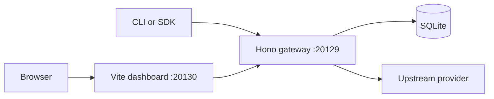
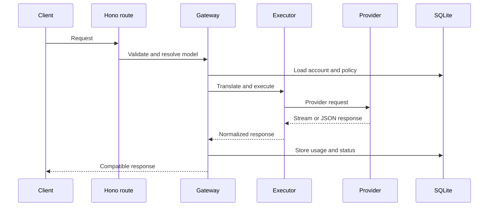

# LobakAI Architecture

_Last updated: 2026-08-27_

## Summary

LobakAI runs a local AI gateway and dashboard.

The backend accepts OpenAI-compatible and provider-specific requests.

The backend translates requests for upstream AI providers.

The dashboard manages providers, accounts, models, keys, and usage.

## Runtime topology

The backend starts on `127.0.0.1:20129` by default.

The frontend starts on `127.0.0.1:20130` by default.

The frontend proxies gateway paths to the backend.

Docker deployments may bind both listeners to `0.0.0.0`.

## Backend

`backend/src/main.ts` starts the Bun server.

`backend/src/app.ts` registers Hono routes.

`backend/src/runtime.ts` creates the SQLite database and runtime services.

`backend/src/routes/` implements dashboard and compatibility API routes.

`backend/src/services/` implements authentication, execution, fallback, media, and host operations.

`backend/src/db/` defines migrations, schema, and repositories.

The backend exposes these public endpoint groups.

- `/api/*` manages local configuration and dashboard data.
- `/v1/*` supports OpenAI-compatible clients.
- `/v1beta/*` supports Gemini compatibility clients.
- `/responses` supports OpenAI Responses clients.
- `/codex` supports Codex clients.

## Request flow

The gateway resolves aliases, combos, providers, and credentials.

The execution layer retries refreshable authentication failures.

The fallback layer selects another account or combo model after eligible errors.

The usage layer stores normalized request usage in SQLite.

## Persistence

The backend uses SQLite through `bun:sqlite` and Drizzle.

`BACKEND_DATABASE_PATH` selects the database file.

`DATA_DIR` selects the default data directory.

The default database path is `${DATA_DIR}/db/data.sqlite`.

The repository stores no runtime database files.

## Frontend

`frontend/src/` contains the Vue application.

`frontend/src/router/` defines dashboard navigation.

`frontend/src/views/` defines dashboard pages.

`frontend/src/lib/api.ts` calls relative API paths.

`frontend/vite.config.ts` proxies API paths during development and preview.

`frontend/public/` stores fonts, locale files, provider assets, and the favicon.

## Product service layout

`backend/src/services/` holds typed product domains.

`chat` handles execution, translation, fallback, and token savers.

`providers` handles registry, capabilities, discovery, OAuth, and CLI auth.

`billing` handles usage tracking and pricing.

`media` handles embeddings, images, search, STT, TTS, and fetch.

`platform` handles tunnels, database, MITM, devices, jobs, and keys.

`common` handles proxy fetch, errors, SSE, usage, and versions.

## Security

Set `JWT_SECRET` before production deployment.

Replace the default `INITIAL_PASSWORD` before production deployment.

Set `API_KEY_SECRET` before generating production API keys.

Protect the SQLite data directory with operating-system permissions.

Protect provider credentials in backups and logs.

## Deployment

The repository provides Docker and PM2 configurations.

Docker exposes backend port `20129` and dashboard port `20130`.

PM2 runs the backend and frontend as separate Bun processes.

Set `VITE_BACKEND_ORIGIN` when the frontend requires a non-default backend address.

## Verification

Run `bun install` after dependency changes.

Run `bun run typecheck` before release.

Run `bun run test` before release.

Run `bun run build` before preview deployment.
